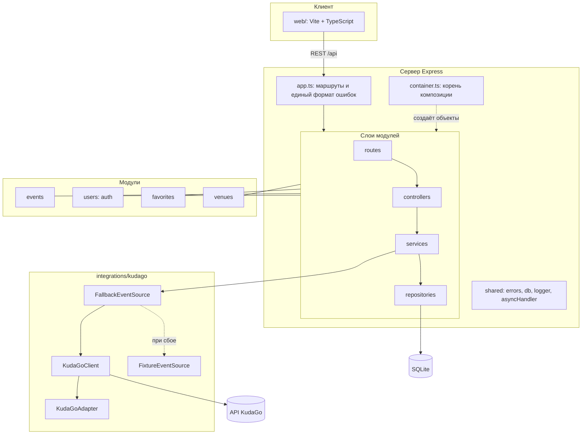

# Архитектура, паттерны и стандарты (шаг 7)

## Диаграмма архитектуры модулей

## Применённые паттерны проектирования

| Паттерн | Где применён | Зачем |
| --- | --- | --- |
| Adapter | `KudaGoAdapter` | превращает ответ KudaGo во внутренние модели, остальной код не знает формата чужого API |
| Factory | `EventFactory` | по категории создаёт нужный подкласс `Event` |
| Repository | `IEventRepository`, `IUserRepository`, `IFavoriteRepository` и реализации `Sqlite*` | сервисы не зависят от конкретной БД, в тестах подставляются заглушки |
| Strategy | `CategoryFilter`, `FreeOnlyFilter`, `DateRangeFilter`, `TextSearchFilter`, `SortByDate`, `SortByTitle` | фильтры и сортировки взаимозаменяемы и комбинируются |
| Dependency Injection | `container.ts`, конструкторы классов | нет глобальных синглтонов, кроме конфигурации |
| Fallback (запасной источник) | `FallbackEventSource` | при сбое KudaGo данные берутся из JSON |
| Template Method | `Event.toJSON()` и `extraFields()` | общая часть в базовом классе, доп. поля задают наследники |

## Принципы ООП в коде

- **Инкапсуляция:** данные `Event`, `User`, `Venue` лежат в приватном поле `props`, наружу открыты только геттеры.
- **Наследование:** абстрактный `Event` и наследники `Concert`, `Performance`, `Exhibition`, `Movie`.
- **Полиморфизм:** `describe()`, `category`, `isActiveAt()` переопределяются в наследниках; сервисы работают с типом `Event`.
- **Абстракции:** интерфейсы `EventSource`, репозиториев, `PasswordHasher`, `TokenService`.

## Применённые стандарты и практики

| Область | Что использовано |
| --- | --- |
| Стиль кода | ESLint (`typescript-eslint`, правила `eqeqeq`, `no-console`, `explicit-member-accessibility`) и Prettier |
| Типизация | TypeScript в режиме `strict`, `noUncheckedIndexedAccess`, `noImplicitOverride` |
| API | REST, коды ответов по смыслу (200, 201, 204, 400, 401, 404, 409, 502, 504), единый формат ошибок `{ error: { status, message } }` |
| Безопасность | bcrypt для паролей, JWT с ограниченным сроком, хэш пароля не попадает в ответы, секреты в `.env`, параметризованные SQL-запросы, вывод текста во фронтенде через `textContent` |
| Надёжность | тайм-ауты и преобразование сбоев KudaGo в `IntegrationError` (502/504), кэш в SQLite, запасной JSON, журналирование |
| Тестирование | Vitest и supertest, юнит и интеграционные тесты, порог покрытия 70% |
| Git | сообщения коммитов по схеме Conventional Commits (feat, fix, test, docs, refactor) |
| Документация | Mermaid-диаграммы в `docs/`; по ЕСПД (ГОСТ 19.xxx) для отчёта обычно берут 19.402 «Описание программы», 19.502 «Описание применения», 19.301 «Программа и методика испытаний». Какие именно нужны, уточните у руководителя практики |
