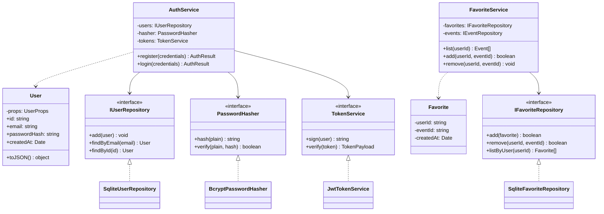
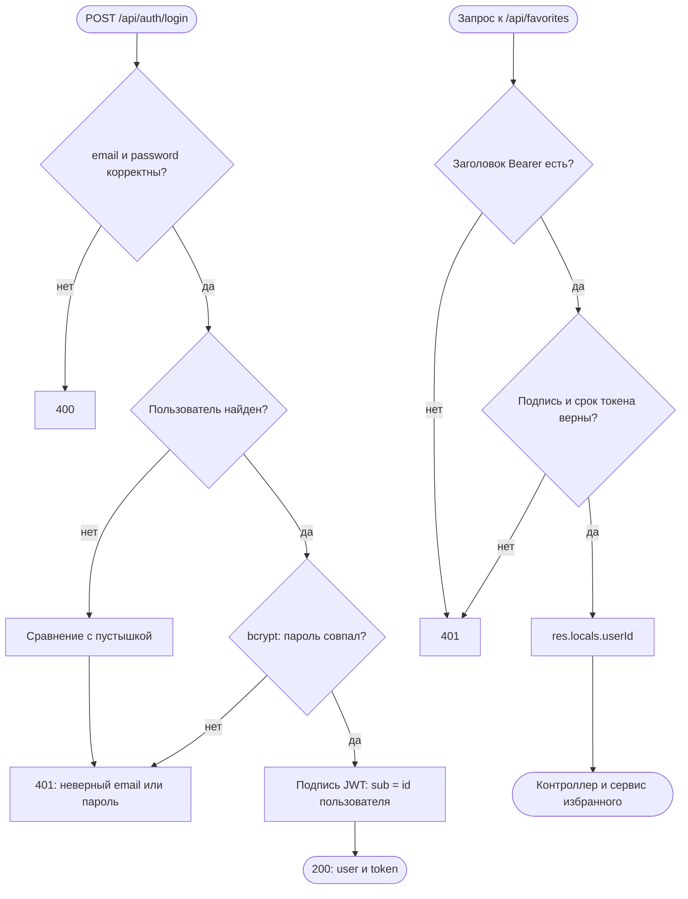

# Авторизация и избранное (шаг 5)

Пользователь регистрируется по email и паролю, получает JWT и передаёт его в заголовке
`Authorization: Bearer <токен>`. Маршруты `/api/favorites` доступны только с токеном.

## Диаграмма классов

## Алгоритм входа и защиты маршрутов

## Эндпоинты

| Метод и путь | Доступ | Ответы |
| --- | --- | --- |
| `POST /api/auth/register` | открыт | 201 `{user, token}`, 400, 409 |
| `POST /api/auth/login` | открыт | 200 `{user, token}`, 400, 401 |
| `GET /api/favorites` | токен | 200 `{items}`, 401 |
| `POST /api/favorites/:eventId` | токен | 201 добавлено, 200 уже было, 404 нет события |
| `DELETE /api/favorites/:eventId` | токен | 204, 404 нет в избранном |

## Меры безопасности

- Пароль хранится только как bcrypt-хэш, хэш не попадает в ответы API.
- Пароль от 8 символов и не длиннее 72 байт (ограничение bcrypt).
- Неверный пароль и неизвестный email дают одинаковый ответ 401, время ответа выравнивается.
- Секрет JWT берётся из `.env`; в production приложение не стартует без `JWT_SECRET`.
- Допустим только алгоритм HS256 при проверке токена.
