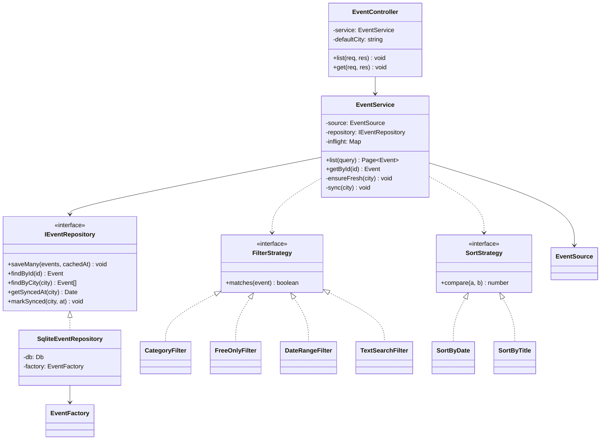
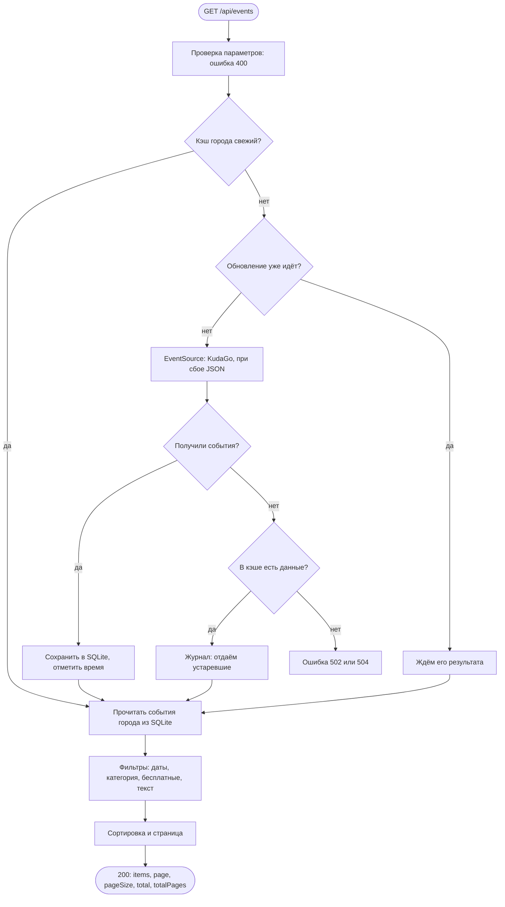

# Сервис событий и кэш (шаг 4)

Запрос списка событий идёт по цепочке `routes → controller → service → repository → SQLite`.
Источник данных (`EventSource`) подключается к сервису через конструктор и вызывается только
тогда, когда кэш города устарел.

## Диаграмма классов

## Алгоритм получения событий с кэшем и запасным вариантом

## Параметры GET /api/events

| Параметр | Значение | По умолчанию |
| --- | --- | --- |
| `city` | код города: `spb`, `msk` | `DEFAULT_CITY` |
| `category` | `concert`, `theater`, `exhibition`, `cinema` | любая |
| `dateFrom`, `dateTo` | `ГГГГ-ММ-ДД` или ISO 8601 | от текущего момента |
| `free` | `true` — только бесплатные | без ограничения |
| `q` | текст до 100 символов | без поиска |
| `sort` | `date`, `title` | `date` |
| `page`, `pageSize` | от 1; размер страницы 1–50 | 1 и 20 |

Событие попадает в выборку, если оно не закончилось к `dateFrom` и началось не позже `dateTo`.
Постоянная экспозиция всегда считается актуальной.

`GET /api/events/:id` отдаёт событие из кэша; если такого нет, ответ 404.
