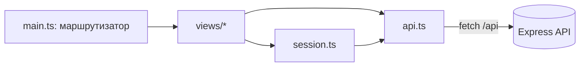

# Фронтенд (шаг 6)

Одностраничное приложение на Vite + TypeScript без фреймворка. Лежит в `web/`, с сервером общается только через REST API (`/api/...`).
В режиме разработки Vite проксирует `/api` на Express (порт 3000).

## Структура

| Файл | Назначение |
| --- | --- |
| `web/src/main.ts` | точка входа, маршрутизатор по `location.hash`, верхнее меню |
| `web/src/api.ts` | класс `ApiError`, обёртка над `fetch`, методы API, хранение JWT |
| `web/src/session.ts` | класс `Session`: пользователь и множество id избранного |
| `web/src/dom.ts` | функция `el()` для создания элементов, форматирование дат и цены |
| `web/src/views/*` | экраны: список, страница события, вход/регистрация, избранное |

## Маршруты

| Хэш | Экран |
| --- | --- |
| `#/` | список событий с фильтрами и пагинацией |
| `#/event/:id` | страница события |
| `#/login`, `#/register` | вход и регистрация |
| `#/favorites` | избранное (только для авторизованных) |

## Диаграмма модулей

## Безопасность и обработка ошибок

- Текст из API вставляется через `textContent` (функция `el`), поэтому HTML из данных не исполняется.
- Адреса картинок пропускаются только со схемой `http(s)`.
- Ошибки API (400, 401, 404, 502, 504) и отсутствие связи показываются в блоке `.alert`.
- При ответе 401 на запрос избранного сессия сбрасывается.
- Токен хранится в `localStorage` (для учебного проекта; в production лучше httpOnly-cookie).

## Тестовые сценарии для отчёта

| № | Действие | Ожидаемый результат |
| --- | --- | --- |
| 1 | Открыть `/` | загружается список, 12 карточек на странице |
| 2 | Выбрать категорию «Концерты», «Найти» | остаются только концерты |
| 3 | Включить «Только бесплатные» | в списке только события с ценой «Бесплатно» |
| 4 | Ввести текст в поиск | остаются события с этим текстом |
| 5 | Нажать «Вперёд →» | открывается страница 2 |
| 6 | Открыть карточку | страница события: место, даты, цена |
| 7 | Нажать «В избранное» без входа | переход на `#/login` |
| 8 | Зарегистрироваться и добавить событие | кнопка становится «★ В избранном», событие есть в `#/favorites` |
| 9 | Остановить сервер, обновить список | сообщение «Нет связи с сервером…» |
