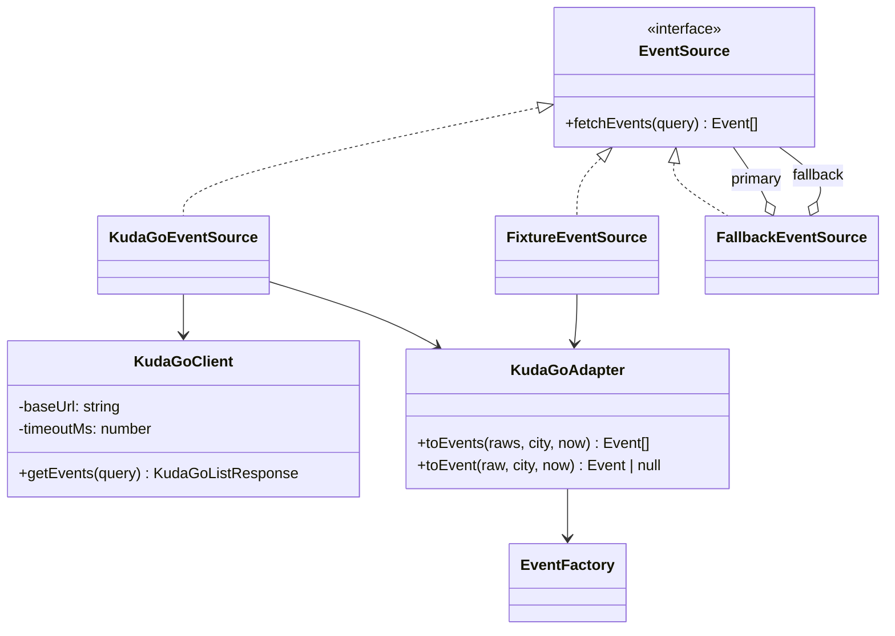
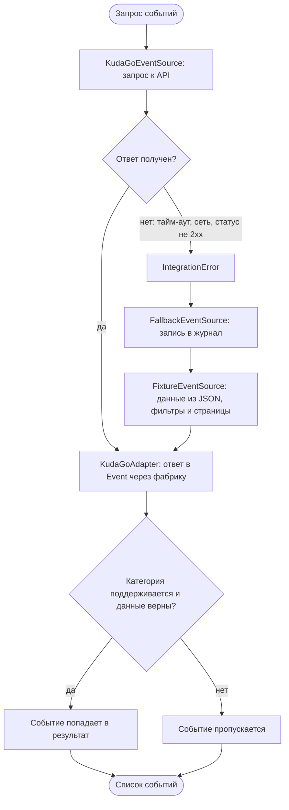

# Интеграция с KudaGo API (шаг 3)

Сервисы приложения зависят от интерфейса `EventSource`. Реальный API, запасные данные
и механизм переключения — это его реализации.

## Структура

## Алгоритм получения событий с запасным вариантом

## Правила адаптера

- Категория: `concert`, `theater`, `exhibition`, `cinema`; `permanent-exhibitions` даёт `Exhibition` с `permanent = true`.
- Даты: из списка берётся ближайший не закончившийся сеанс. «Бессрочные» метки времени (меньше 0 или больше 4·10⁹ секунд) отбрасываются.
- Событие с неверными данными (пустое название и т.п.) или неподдерживаемой категорией пропускается.
- Возраст `"12+"` превращается в число 12.
